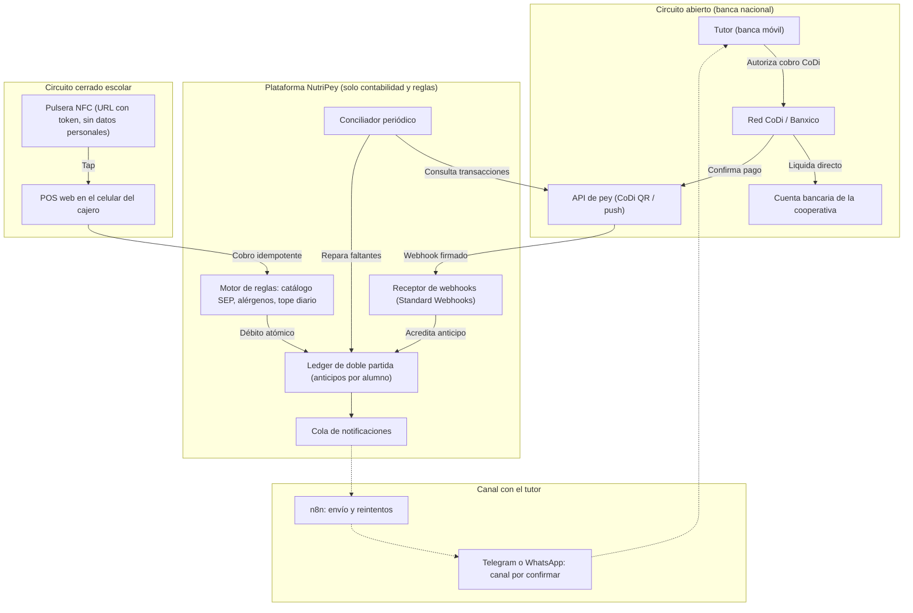

# NutriPey

Cobro sin efectivo para cooperativas escolares, con recarga por CoDi y cumplimiento de la norma de alimentación saludable.

> Proyecto del **Hackatón México 2026** (AI Builders México, SpaceXAI Ambassadors, pey, SEDECO CDMX y Cursor).
> Estado: **especificación**. El código de aplicación aún no existe. Entrega principal: **12 de diciembre de 2026**; el kickoff del 15 de noviembre es un prototipo previo. Punto de retoma: [docs/07_estado_y_siguientes_pasos.md](./docs/07_estado_y_siguientes_pasos.md).

## Resumen

El tutor recarga por CoDi desde su banca, el alumno paga con una pulsera NFC y la cooperativa cobra con el celular que ya tiene.

NutriPey atiende tres problemas:

1. **Efectivo en manos de niños:** dinero que se pierde, se roba o se gasta sin que el tutor sepa en qué. *(Hipótesis por validar con entrevistas.)*
2. **Costo de cobrar con tarjeta:** las terminales cobran entre 2.5% y 4% de comisión, lo que hace inviables las ventas de $5 a $20.
3. **Cumplimiento sin evidencia:** desde marzo de 2025 las escuelas no pueden vender productos con sellos de advertencia, pero no tienen forma de demostrar qué vende su cooperativa.

**Principio rector: NutriPey nunca custodia dinero.** Cada recarga se liquida directamente en la cuenta bancaria de la cooperativa. El saldo del alumno es un anticipo de consumo ante esa cooperativa, y NutriPey lleva su contabilidad.

## Arquitectura

Circuito abierto para recargar, circuito cerrado para cobrar en la escuela. Decididos: monolito modular Next.js + PostgreSQL y AWS. Propuesta del PR #18: Docker y despliegue inicial en EC2. n8n orquesta avisos fuera de la transacción. Lambda/SQS y Bedrock son evaluaciones opcionales, no servicios implementados.



Objetivo de latencia en caja: p95 ≤ 800 ms de extremo a extremo.

## Marco regulatorio

| Norma | Relevancia para NutriPey |
| :--- | :--- |
| **Ley de Economía Digital para Pagos Digitales y Electrónicos** (DOF 4 nov 2026) | Impulsa SPEI, CoDi y DiMo. Para los comercios es voluntaria salvo sectores que defina la SHCP. |
| **Cuentas Nivel 2 Bis**, Circular 11/2026 de Banxico (DOF 17 jun 2026) | Apertura simplificada para personas físicas. Hasta 15,000 UDIs de abonos al mes (unos $132,000), máximo 3,000 en efectivo. Alcanza para unos 220 alumnos activos. Los bancos tienen hasta el 14 dic 2026 para ofrecerla; NutriPey funciona con cualquier CLABE con CoDi. |
| **Lineamientos SEP de alimentos en escuelas** (obligatorios desde el 29 mar 2025) | Prohíben vender productos con sellos o leyendas de advertencia. NutriPey lo aplica desde el catálogo y genera el reporte de cumplimiento. |
| **LFPDPPP** (DOF 20 mar 2025) | Las alergias son datos sensibles: consentimiento expreso del tutor. |

Las cifras regulatorias deben confirmarse en el DOF antes de presentarse. Fuentes en [la auditoría](./docs/05_auditoria_y_decisiones.md#7-fuentes).

## Documentación

| # | Documento | Contenido |
| :- | :--- | :--- |
| 01 | [Requisitos](./docs/01_requisitos.md) | Requisitos funcionales, no funcionales y reglas de negocio. |
| 02 | [Modelo de datos](./docs/02_modelo_de_datos.md) | ERD, ledger de doble partida, transacción de cobro e índices. |
| 03 | [Flujos](./docs/03_flujos.md) | Recarga CoDi, conciliación, cobro en caja y ciclo de vida de la credencial. |
| 04 | [Seguridad y cumplimiento](./docs/04_seguridad_y_cumplimiento.md) | Custodia de fondos, datos de menores, webhooks y clonación NFC. |
| 05 | [Auditoría y decisiones](./docs/05_auditoria_y_decisiones.md) | Hallazgos sobre la v1.0, razones de cada cambio y decisiones abiertas. |
| 06 | [Trabajo colaborativo](./docs/06_trabajo_colaborativo.md) | Carriles, ramas y papel de cada herramienta de IA. |
| 07 | [Estado y siguientes pasos](./docs/07_estado_y_siguientes_pasos.md) | Punto de retoma y tareas en orden. |
| 08 | [Spec de entrega](./docs/08_spec_entrega_diciembre.md) | Alcances, arquitectura, criterios de aceptación y decisiones. |
| Plan | [Plan de ejecución](./docs/superpowers/plans/2026-11-15-entrega-diciembre.md) | Tareas, rutas, dependencias, responsables y verificaciones. |
| — | [Contrato del ledger](./docs/contratos/ledger.md) | Frontera entre los carriles Pagos y Campus (borrador). |
| — | [Análisis](./analisis/README.md) | Datos de la SEP y ENSANUT con gráficas en R. |

## Estructura del repositorio

```text
.
├── AGENTS.md              Reglas para agentes de código (Codex, Antigravity, Claude Code)
├── CLAUDE.md              Entrada de Claude Code; importa AGENTS.md
├── CONTRIBUTING.md        Cómo contribuir
├── .claude/
│   ├── skills/            Guías: integración pey, cambios al ledger, despliegue
│   └── agents/            Subagentes revisores (solo lectura)
├── .github/               Plantillas de PR e issue, CI
├── analisis/              Datos y gráficas en R (proyecto de RStudio)
├── docs/                  especificación y planificación
│   └── contratos/         Interfaces acordadas entre carriles
└── scripts/               Verificación de enlaces y alta de issues
```

## Cómo contribuir

Lee [CONTRIBUTING.md](./CONTRIBUTING.md). En resumen: un issue, una rama, un PR, y nunca commits directos a `main`. Las reglas completas para personas y agentes están en [AGENTS.md](./AGENTS.md).

## Roadmap (14 nov – 12 dic 2026)

| Fase | Periodo | Entregables |
| :--- | :--- | :--- |
| 1. Validación y especificación | 14 – 15 nov | Prototipo kickoff separado del producto; contrato, Docker y trámites pey/canal/NFC. |
| 2. Motor de pagos CoDi | 16 – 22 nov | Núcleo Pagos: CoDi, ledger, cobro, reverso y conciliador; concurrencia e idempotencia con PostgreSQL. Pruebas pey de $0.01. |
| 3. POS y NFC | 23 – 30 nov | Tras validar Pagos: POS, tutor, Web NFC, catálogo, reglas reales y reportes. |
| 4. Notificaciones y endurecimiento | 1 – 7 dic | AWS, notificaciones n8n, respaldo/restauración, carga y presupuesto; evaluar Lambda/Bedrock. |
| 5. Demo final | 8 – 12 dic | Estabilización desde el 8, demo real y video de respaldo; confirmar formato y hora final del evento. |

Fuera del MVP: operación offline, varias cuentas receptoras por escuela y reembolso automático de saldo.
