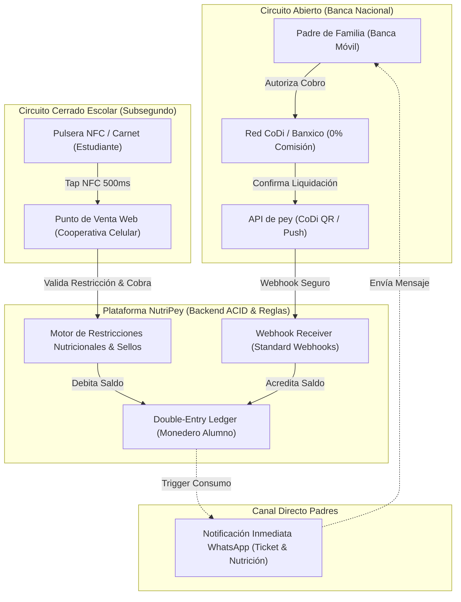

# NutriPey (RecreoPey) — Ecosistema Escolar de Pagos Digitales con CoDi
> **Hackatón México 2026** — *AI Builders México, SpaceXAI Ambassadors, pey, SEDECO CDMX y Cursor*  
> **Subdominio de Producción:** [nutripey.y4ga.app](https://nutripey.y4ga.app) *(Previsto)*  
> **Marco Legal:** *Ley de Economía Digital para Pagos Digitales y Electrónicos (DOF Noviembre 2026)* & *Cuentas Nivel 2 Bis (Circular 11/2026 Banxico / CNBV)*

---

## 🌟 Resumen Ejecutivo

**NutriPey** es una infraestructura de pagos e inclusión financiera escolar diseñada para digitalizar de raíz las cooperativas, cafeterías y tienditas de escuelas de nivel básico y medio superior en México.

El proyecto resuelve tres problemáticas críticas de la Ciudad de México y del país:
1. **Riesgo y Fricción del Efectivo Infantil:** Miles de estudiantes pierden, sufren robos o extravían dinero físico diariamente.
2. **Exclusión y Costos de Terminales para Cooperativas:** Las tienditas escolares operan en informalidad o con terminales tradicionales que cobran del 2.5% al 4% de comisión, inviabilizando microtransacciones de $5 a $20 pesos.
3. **Salud Pública Infantil y Regulación Escolar:** Falta de trazabilidad en el consumo alimenticio escolar frente al nuevo decreto nacional de erradicación de comida chatarra y sellos negros en recintos educativos.

---

## 📐 Arquitectura Híbrida: *Open-Loop on Ramps, Closed-Loop on Campus*

---

## ⚖️ Marco Regulatorio e Institucional

### 1. Ley de Economía Digital para Pagos Digitales y Electrónicos (DOF 2026)
NutriPey se fundamenta en la legislación federal que promueve la erradicación del efectivo en comercios barriales y comunitarios, garantizando interoperabilidad mediante tecnologías abiertas (QR y NFC) sin comisiones abusivas para los microcomercios.

### 2. Cuentas Nivel 2 Bis (N2Bis - Banxico / CNBV)
- **Apertura 100% Digital:** La cooperativa o mesa directiva escolar abre su cuenta bancaria N2Bis en minutos desde el móvil sin necesidad de actas constitutivas corporativas.
- **Límite Operativo de 15,000 UDIs/mes (~$132,000 MXN):** Escala idónea para el flujo de una escuela.
- **Cumplimiento Mandatorio de Pagos Digitales:** Banxico exige que al menos **12,000 UDIs provengan obligatoriamente de medios digitales**. NutriPey canaliza el 100% de los ingresos de la cafetería escolar vía CoDi, asegurando cumplimiento legal estricto.

---

## 📚 Documentación Técnica y Especificaciones

Toda la documentación técnica formal se encuentra versionada en la carpeta [`docs/`](./docs/):

1. **[Especificación de Requerimientos del Sistema (SRS)](./docs/spec/01_requirements_specification.md):** Requerimientos funcionales, no funcionales, reglas de negocio e interfaces.
2. **[Modelo de Datos y Diagrama Entidad-Relación (ERD)](./docs/diagrams/02_data_model_erd.md):** Esquema relacional estricto con doble partida contable (*double-entry ledger*).
3. **[Diagramas de Flujo y Secuencia](./docs/diagrams/03_system_flows.md):** Flujo de recarga CoDi con pey, autorización en caja con Web NFC y notificaciones WhatsApp.
4. **[Plan de Mitigación de Riesgos y Seguridad](./docs/spec/04_security_and_compliance.md):** Criptografía de firmas de webhooks, mitigación de clonación NFC y protección de datos personales de menores.

---

## 🗓️ Roadmap Nacional de Construcción (14 Nov - 12 Dic 2026)

| Fase | Periodo | Hito Principal | Entregables |
| :--- | :--- | :--- | :--- |
| **Fase 1: Validación y Especificación** | 14 - 15 Nov | Kickoff CDMX & Registro Inicial | Repositorio formal, arquitectura, spec y propuesta SEDECO. |
| **Fase 2: Motor de Pagos CoDi** | 16 - 22 Nov | Integración con pey | Clientes CoDi QR/PN, Standard Webhooks con Svix y conciliación N2Bis. |
| **Fase 3: IoT, Web NFC y POS** | 23 - 30 Nov | Experiencia en Campus | PWA móvil con Web NFC API, emulación de tags y motor nutricional. |
| **Fase 4: WhatsApp & Hardening** | 1 - 7 Dic | Comunicación & Resiliencia | Notificaciones WhatsApp automáticas, auditoría de concurrencia y seguridad. |
| **Fase 5: Demo Final y Pitch** | 8 - 12 Dic | Entrega Nacional Oficial | Video demo de 3 min, despliegue en `nutripey.y4ga.app` y defensa ante jurado. |

---

## 👥 Equipo
- **Repositorio:** [github.com/rslnt1270/NutriPey_Hackathon_CDMX_2026](https://github.com/rslnt1270/NutriPey_Hackathon_CDMX_2026)
- **Organización del Evento:** AI Builders México, pey, SpaceXAI, SEDECO CDMX y Cursor.
