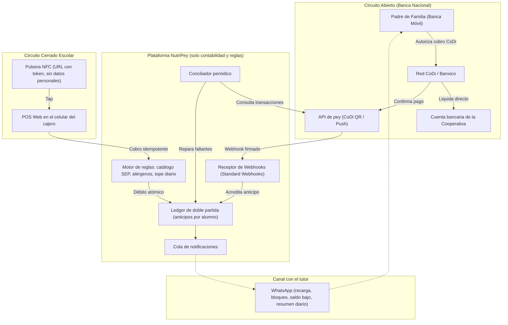

# NutriPey (RecreoPey) — Ecosistema Escolar de Pagos Digitales con CoDi
> **Hackatón México 2026** — *AI Builders México, SpaceXAI Ambassadors, pey, SEDECO CDMX y Cursor*  
> **Subdominio de Producción:** [nutripey.y4ga.app](https://nutripey.y4ga.app) *(Previsto)*  
> **Marco de referencia:** *Ley de Economía Digital para Pagos Digitales y Electrónicos (DOF 4 nov 2026)*, *Cuentas Nivel 2 Bis (Circular 11/2026 de Banxico, DOF 17 jun 2026)* y *Lineamientos SEP de alimentos en escuelas (obligatorios desde el 29 mar 2025)*

---

## 🌟 Resumen Ejecutivo

**NutriPey** es el software con el que una cooperativa escolar cobra sin efectivo y demuestra que cumple la norma de alimentación saludable. El padre recarga por CoDi desde su banca, el alumno paga con una pulsera NFC y la cooperativa cobra con el celular que ya tiene.

El proyecto atiende tres problemas:
1. **Efectivo en manos de niños:** dinero que se pierde, se roba o se gasta sin que el tutor sepa en qué. *(Hipótesis por validar con entrevistas a padres y cooperativas.)*
2. **Costo de cobrar con tarjeta:** las terminales tradicionales cobran entre 2.5% y 4% de comisión, lo que hace inviables las ventas de $5 a $20 pesos.
3. **Cumplimiento sin evidencia:** desde marzo de 2025 las escuelas no pueden vender productos con sellos o leyendas de advertencia, pero no tienen forma de demostrar qué se vende en su cooperativa.

**Principio rector: NutriPey nunca custodia dinero.** Cada recarga se liquida directamente en la cuenta bancaria de la cooperativa. El saldo del alumno es un anticipo de consumo ante esa cooperativa, y NutriPey lleva su contabilidad.

---

## 📐 Arquitectura Híbrida: *Open-Loop on Ramps, Closed-Loop on Campus*

**Objetivo de latencia en caja:** p95 ≤ 800 ms de extremo a extremo.

---

## ⚖️ Marco Regulatorio e Institucional

### 1. Ley de Economía Digital para Pagos Digitales y Electrónicos (DOF 4 nov 2026)
Faculta a la SHCP y a Banxico para promover los pagos con SPEI, CoDi y DiMo. Para los comercios la adopción es voluntaria, salvo en los sectores que defina la SHCP. NutriPey se alinea con ese impulso; no depende de una obligación legal.

### 2. Cuentas Nivel 2 Bis (Circular 11/2026 de Banxico)
- **Apertura simplificada** con identificación oficial y comprobante de domicilio. Está dirigida a personas físicas, por ejemplo el concesionario de la cooperativa.
- **Abonos de hasta 15,000 UDIs al mes** (unos $132,000 MXN), de los cuales **máximo 3,000 UDIs pueden ser depósitos en efectivo**.
- **Alcance:** cubre una cooperativa de unos 220 alumnos activos. Las escuelas más grandes requieren una cuenta de nivel superior.
- **Disponibilidad:** los bancos tienen hasta el 14 de diciembre de 2026 para ofrecerla. NutriPey funciona con cualquier CLABE que tenga CoDi habilitado; N2Bis es la vía de formalización recomendada, no un requisito.

### 3. Lineamientos SEP de alimentos y bebidas en escuelas
Prohíben la venta de productos con sellos o leyendas de advertencia dentro de los planteles. NutriPey lo aplica desde el catálogo y genera el reporte de cumplimiento de la escuela.

### 4. Protección de datos de menores
Nueva LFPDPPP (DOF 20 mar 2025). Las alergias son datos sensibles y requieren consentimiento expreso del tutor.

> Las afirmaciones regulatorias deben confirmarse en el texto del DOF antes de presentarse ante el jurado. Ver [fuentes](./docs/05_auditoria_y_decisiones.md#7-fuentes).

---

## 📚 Documentación Técnica y Especificaciones

1. **[Especificación de Requerimientos (SRS)](./docs/spec/01_requirements_specification.md):** requerimientos funcionales, no funcionales y reglas de negocio.
2. **[Modelo de Datos y ERD](./docs/diagrams/02_data_model_erd.md):** esquema relacional con ledger de doble partida.
3. **[Diagramas de Flujo y Secuencia](./docs/diagrams/03_system_flows.md):** recarga CoDi con pey, cobro en caja y ciclo de vida de la credencial.
4. **[Seguridad, Privacidad y Cumplimiento](./docs/spec/04_security_and_compliance.md):** webhooks, clonación NFC y datos de menores.
5. **[Auditoría y Decisiones](./docs/05_auditoria_y_decisiones.md):** hallazgos de la revisión de la v1.0, razones de cada cambio y decisiones abiertas.
6. **[Trabajo Colaborativo](./docs/06_trabajo_colaborativo.md):** carriles, ramas y papel de cada herramienta. Reglas para agentes en [AGENTS.md](./AGENTS.md).
7. **[Estado y Siguientes Pasos](./docs/07_estado_y_siguientes_pasos.md):** punto de retoma y lista de tareas en orden.

---

## 🗓️ Roadmap (14 Nov - 12 Dic 2026)

| Fase | Periodo | Hito Principal | Entregables |
| :--- | :--- | :--- | :--- |
| **Fase 1: Validación y Especificación** | 14 - 15 Nov | Kickoff CDMX y registro | Repositorio, arquitectura y spec. **Trámites que arrancan hoy:** registro de la CLABE en pey (hasta 5 días hábiles), plantillas de WhatsApp y compra de tags. |
| **Fase 2: Motor de Pagos CoDi** | 16 - 22 Nov | Integración con pey | CoDi QR y push, webhook verificado, ledger, conciliador. Pruebas en producción con $0.01 MXN (pey no tiene sandbox). |
| **Fase 3: POS y NFC** | 23 - 30 Nov | Experiencia en caja | PWA con Web NFC, cobro idempotente, catálogo SEP, reglas del tutor, fallback QR. |
| **Fase 4: Notificaciones y Hardening** | 1 - 7 Dic | Resiliencia | Cola de WhatsApp, pruebas de concurrencia, anulaciones, reporte de cumplimiento. |
| **Fase 5: Demo Final y Pitch** | 8 - 12 Dic | Entrega nacional | Video de 3 min, despliegue en `nutripey.y4ga.app` y defensa ante jurado. |

**Fuera del MVP:** operación offline, varias cuentas receptoras por escuela, reembolso automático de saldo.

---

## 👥 Equipo
- **Repositorio:** [github.com/rslnt1270/NutriPey_Hackathon_CDMX_2026](https://github.com/rslnt1270/NutriPey_Hackathon_CDMX_2026)
- **Organización del Evento:** AI Builders México, pey, SpaceXAI, SEDECO CDMX y Cursor.
