# Modelo de Datos y Diagrama Entidad-Relación (ERD) — NutriPey

**Versión:** 1.1  
**Arquitectura de Datos:** PostgreSQL con ledger de doble partida.  
**Cambios respecto a 1.0:** ver [Auditoría y Decisiones](./05_auditoria_y_decisiones.md#a3-modelo-de-datos).

Convenciones: los montos son enteros en centavos (`bigint`), las fechas son `timestamptz` en UTC y los identificadores propios son UUID.

---

Extensión planificada v1.2: #4 y #13 definirán canal/destino verificado (chat_id para Telegram, no teléfono), consentimiento de mensajería, lease e identificador/estado del proveedor en una migración nueva. Este ERD conserva el modelo base; no implementa todavía esas extensiones. `transaccion_id` en outbox debe admitir nulo para rechazos sin movimiento contable. Ver [spec](./08_spec_entrega_diciembre.md).

## 1. Diagrama Entidad-Relación

```mermaid
erDiagram
    ESCUELA ||--o{ COOPERATIVA : opera
    ESCUELA ||--o{ ESTUDIANTE : matricula
    COOPERATIVA ||--o{ OPERADOR : emplea
    COOPERATIVA ||--o{ PRODUCTO : cataloga
    COOPERATIVA ||--o{ CUENTA_LEDGER : agrupa
    TUTOR ||--o{ TUTOR_ESTUDIANTE : participa
    ESTUDIANTE ||--o{ TUTOR_ESTUDIANTE : participa
    TUTOR ||--o{ CONSENTIMIENTO : otorga
    ESTUDIANTE ||--o{ CONSENTIMIENTO : ampara
    ESTUDIANTE ||--o{ CREDENCIAL : porta
    ESTUDIANTE ||--o| REGLA_TUTOR : tiene
    ESTUDIANTE ||--|| CUENTA_LEDGER : anticipo
    TUTOR ||--o{ RECARGA : inicia
    ESTUDIANTE ||--o{ RECARGA : recibe
    RECARGA ||--o| TRANSACCION : acredita
    OPERADOR ||--o{ TRANSACCION : ejecuta
    TRANSACCION ||--o{ ASIENTO_CONTABLE : registra
    CUENTA_LEDGER ||--o{ ASIENTO_CONTABLE : afecta
    TRANSACCION ||--o{ DETALLE_VENTA : genera
    PRODUCTO ||--o{ DETALLE_VENTA : incluye
    TRANSACCION ||--o{ NOTIFICACION_OUTBOX : dispara

    ESCUELA {
        uuid id PK
        string cct_clave UK "Clave de Centro de Trabajo SEP"
        string nombre
        string alcaldia
        timestamptz created_at
    }

    COOPERATIVA {
        uuid id PK
        uuid escuela_id FK
        string nombre
        string titular_nombre "Titular de la cuenta receptora"
        string tipo_titular "PERSON | BUSINESS"
        string clabe "Cuenta receptora con CoDi"
        string pey_bank_account_id UK "ULID de POST /bank-account"
        string codi_status "PENDING | PROCESSING | ACTIVE | ERROR"
        bigint limite_abonos_mes_centavos "Nulo si la cuenta no tiene tope"
        boolean activa
    }

    OPERADOR {
        uuid id PK
        uuid cooperativa_id FK
        string nombre
        string rol "CAJERO | ADMIN"
        string credencial_hash
        boolean activo
    }

    TUTOR {
        uuid id PK
        string nombre_completo
        string telefono "10 digitos para CoDi push; WhatsApp si se elige"
        string preferencia_avisos "RESUMEN_DIARIO | POR_COMPRA | SOLO_ALERTAS"
        timestamptz created_at
    }

    TUTOR_ESTUDIANTE {
        uuid tutor_id PK, FK
        uuid estudiante_id PK, FK
        boolean puede_configurar_reglas
    }

    ESTUDIANTE {
        uuid id PK
        uuid escuela_id FK
        string matricula "Unica por escuela"
        string nombre
        string grado_grupo
        string foto_url "Opcional, requiere consentimiento"
        string pin_hash "Segundo factor del fallback"
        boolean activo
    }

    CONSENTIMIENTO {
        uuid id PK
        uuid tutor_id FK
        uuid estudiante_id FK
        string tipo "AVISO_PRIVACIDAD | DATOS_SALUD | FOTO"
        string version_aviso
        timestamptz otorgado_en
        timestamptz revocado_en
    }

    CREDENCIAL {
        uuid id PK
        uuid estudiante_id FK "Nulo mientras esta en inventario"
        string tipo "NFC_NTAG21X | NFC_NTAG424 | QR"
        string token_hash UK "SHA-256 del token; el token no se guarda"
        bytea llave_sdm_cifrada "Solo NTAG 424 DNA"
        int contador_sdm "Ultimo contador aceptado"
        string status "INVENTARIO | ACTIVA | SUSPENDIDA | BAJA"
        timestamptz vinculada_en
    }

    PRODUCTO {
        uuid id PK
        uuid cooperativa_id FK
        string nombre
        bigint precio_centavos
        text_arr sellos "exceso_calorias, exceso_azucares, exceso_sodio, exceso_grasas_saturadas, exceso_grasas_trans"
        text_arr leyendas "cafeina, edulcorantes"
        text_arr alergenos "gluten, lacteos, huevo, nueces, cacahuate, soya, pescado"
        string categoria "BEBIDA | COMIDA_CALIENTE | FRUTA | SNACK"
        boolean publicable "Falso si tiene sellos o leyendas"
        boolean disponible
    }

    REGLA_TUTOR {
        uuid estudiante_id PK, FK
        bytea alergenos_prohibidos_cifrado "Dato sensible"
        text_arr categorias_bloqueadas
        bigint tope_diario_centavos
        timestamptz updated_at
    }

    CUENTA_LEDGER {
        uuid id PK
        uuid cooperativa_id FK
        string tipo "BANCO | CAJA_EFECTIVO | ANTICIPO_ALUMNO | INGRESO_VENTAS"
        uuid estudiante_id FK "Solo para ANTICIPO_ALUMNO"
        bigint saldo_centavos "Materializado, nunca negativo"
        timestamptz created_at
    }

    TRANSACCION {
        uuid id PK
        uuid cooperativa_id FK
        string tipo "RECARGA_CODI | RECARGA_EFECTIVO | COMPRA | REVERSO | REEMBOLSO"
        uuid estudiante_id FK
        uuid operador_id FK "Nulo en recarga CoDi"
        uuid credencial_id FK "Solo en compras"
        uuid transaccion_origen_id FK "Solo en reversos"
        string idempotency_key UK
        bigint monto_centavos
        timestamptz created_at
    }

    ASIENTO_CONTABLE {
        uuid id PK
        uuid transaccion_id FK
        uuid cuenta_ledger_id FK
        string tipo_asiento "DEBITO | CREDITO"
        bigint monto_centavos "Siempre positivo"
        timestamptz created_at
    }

    DETALLE_VENTA {
        uuid id PK
        uuid transaccion_id FK
        uuid producto_id FK
        int cantidad
        bigint precio_unitario_centavos "Precio al momento de la venta"
    }

    RECARGA {
        uuid id PK
        uuid tutor_id FK
        uuid estudiante_id FK
        uuid cooperativa_id FK
        string metodo "CODI_QR | CODI_PN | EFECTIVO"
        bigint monto_centavos
        string pey_codi_qr_id UK "id devuelto por POST /codi/qr"
        string pey_transaction_id UK "ULID del pago"
        string pey_codi_folio "Folio Banxico, solo push"
        string status "PENDIENTE | PAGADA | EXPIRADA | REVISION"
        timestamptz expira_en
        timestamptz pagada_en
    }

    WEBHOOK_EVENTO {
        string webhook_id PK "Cabecera webhook-id"
        string tipo "codi.qr.payment_received, codi.pn.payment_received"
        jsonb payload
        string resultado "ACREDITADO | DUPLICADO | SIN_RECARGA | ERROR"
        timestamptz recibido_en
    }

    NOTIFICACION_OUTBOX {
        uuid id PK
        uuid transaccion_id FK
        uuid tutor_id FK
        string plantilla
        jsonb variables
        string status "PENDIENTE | ENVIADA | FALLIDA"
        int intentos
        timestamptz proximo_intento
    }

    AUDIT_LOG {
        bigint id PK
        string actor_tipo "TUTOR | OPERADOR | SISTEMA"
        uuid actor_id
        string accion
        jsonb detalle
        timestamptz created_at
    }
```



---

## 2. Contabilidad

NutriPey no custodia dinero. El ledger describe, para cada cooperativa, cuánto dinero recibió y cuánto de ese dinero todavía le debe en producto a cada alumno.

| Cuenta | Naturaleza | Significado |
| :--- | :--- | :--- |
| `BANCO` | Activo | Dinero recibido por CoDi en la cuenta de la cooperativa. |
| `CAJA_EFECTIVO` | Activo | Recargas recibidas en efectivo. |
| `ANTICIPO_ALUMNO` | Pasivo | Consumo prepagado que la cooperativa debe al alumno. |
| `INGRESO_VENTAS` | Ingreso | Ventas ya entregadas. |

| Operación | Débito | Crédito |
| :--- | :--- | :--- |
| Recarga CoDi de $100 | `BANCO` | `ANTICIPO_ALUMNO` |
| Recarga en efectivo de $50 | `CAJA_EFECTIVO` | `ANTICIPO_ALUMNO` |
| Compra de $35 | `ANTICIPO_ALUMNO` | `INGRESO_VENTAS` |
| Anulación de la compra | `INGRESO_VENTAS` | `ANTICIPO_ALUMNO` |
| Reembolso de $20 al tutor | `ANTICIPO_ALUMNO` | `BANCO` |

**Invariantes**

1. En cada transacción, la suma de débitos es igual a la suma de créditos. Se verifica con un trigger diferido al confirmar.
2. `saldo_centavos` de cada cuenta es igual al neto de sus asientos. Se actualiza en la misma transacción que los inserta.
3. `CHECK (saldo_centavos >= 0)` en las cuentas `ANTICIPO_ALUMNO`. La base de datos impide el sobregiro aunque falle el código.
4. `ASIENTO_CONTABLE` y `TRANSACCION` solo admiten `INSERT`. Los errores se corrigen con un `REVERSO`.
5. Por cooperativa, la suma de anticipos es igual a `BANCO` más `CAJA_EFECTIVO` menos `INGRESO_VENTAS`. El conciliador diario lo comprueba y compara `BANCO` contra las transacciones que reporta pey.

---

## 3. Transacción de cobro

Toda la validación ocurre dentro de la transacción y bajo el bloqueo de la cuenta. Validar antes de abrirla permitiría que dos taps simultáneos pasaran ambos.

```sql
BEGIN;

-- 1. Idempotencia: si la llave ya existe, se devuelve el resultado original.
INSERT INTO transaccion (id, idempotency_key, tipo, cooperativa_id, estudiante_id,
                         operador_id, credencial_id, monto_centavos)
VALUES ($1, $2, 'COMPRA', $3, $4, $5, $6, $7)
ON CONFLICT (idempotency_key) DO NOTHING;

-- 2. Bloqueo de la cuenta del alumno. Serializa los cobros concurrentes.
SELECT saldo_centavos FROM cuenta_ledger WHERE id = $anticipo FOR UPDATE;

-- 3. Con el bloqueo tomado: reglas del tutor y tope diario
--    (suma de compras menos reversos del dia en America/Mexico_City).

-- 4. Movimiento. El CHECK aborta la transaccion si no alcanza el saldo.
UPDATE cuenta_ledger SET saldo_centavos = saldo_centavos - $7 WHERE id = $anticipo;
UPDATE cuenta_ledger SET saldo_centavos = saldo_centavos + $7 WHERE id = $ingreso;
INSERT INTO asiento_contable (transaccion_id, cuenta_ledger_id, tipo_asiento, monto_centavos)
VALUES ($1, $anticipo, 'DEBITO', $7), ($1, $ingreso, 'CREDITO', $7);

-- 5. Detalle de venta y notificacion en la misma transaccion.
INSERT INTO detalle_venta (...) VALUES (...);
INSERT INTO notificacion_outbox (...) VALUES (...);

COMMIT;
```

Los rechazos de negocio (alérgeno, tope, saldo) no crean una `TRANSACCION`. Se registran en `AUDIT_LOG` y, si corresponde, en `NOTIFICACION_OUTBOX`.

---

## 4. Índices

```sql
CREATE UNIQUE INDEX idx_credencial_token   ON credencial (token_hash);
CREATE UNIQUE INDEX idx_estudiante_matric  ON estudiante (escuela_id, matricula);
CREATE UNIQUE INDEX idx_cuenta_anticipo    ON cuenta_ledger (estudiante_id) WHERE tipo = 'ANTICIPO_ALUMNO';
CREATE INDEX idx_recarga_pendiente         ON recarga (status, expira_en) WHERE status = 'PENDIENTE';
CREATE INDEX idx_tx_estudiante_dia         ON transaccion (estudiante_id, created_at DESC);
CREATE INDEX idx_asiento_cuenta            ON asiento_contable (cuenta_ledger_id, created_at DESC);
CREATE INDEX idx_outbox_pendiente          ON notificacion_outbox (proximo_intento) WHERE status = 'PENDIENTE';
```

El cobro resuelve credencial, alumno, reglas y cuenta con cuatro lecturas por llave. No suma asientos.
