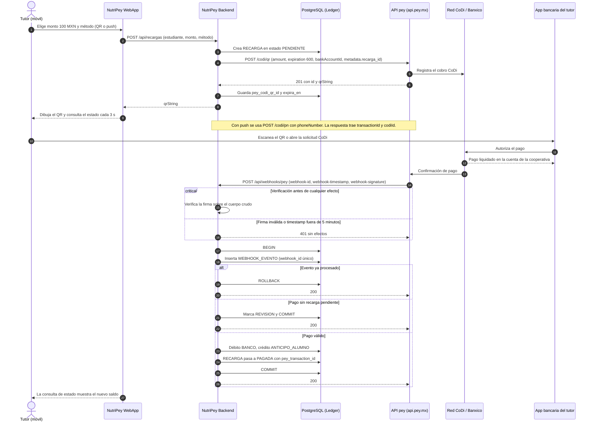
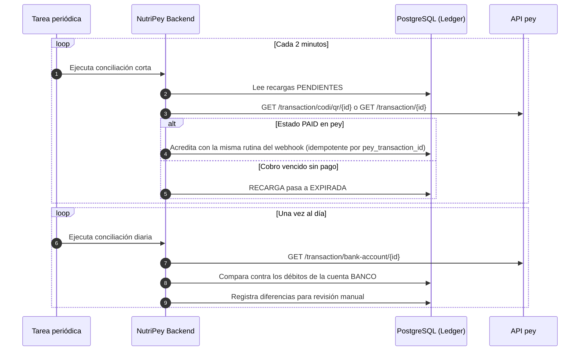
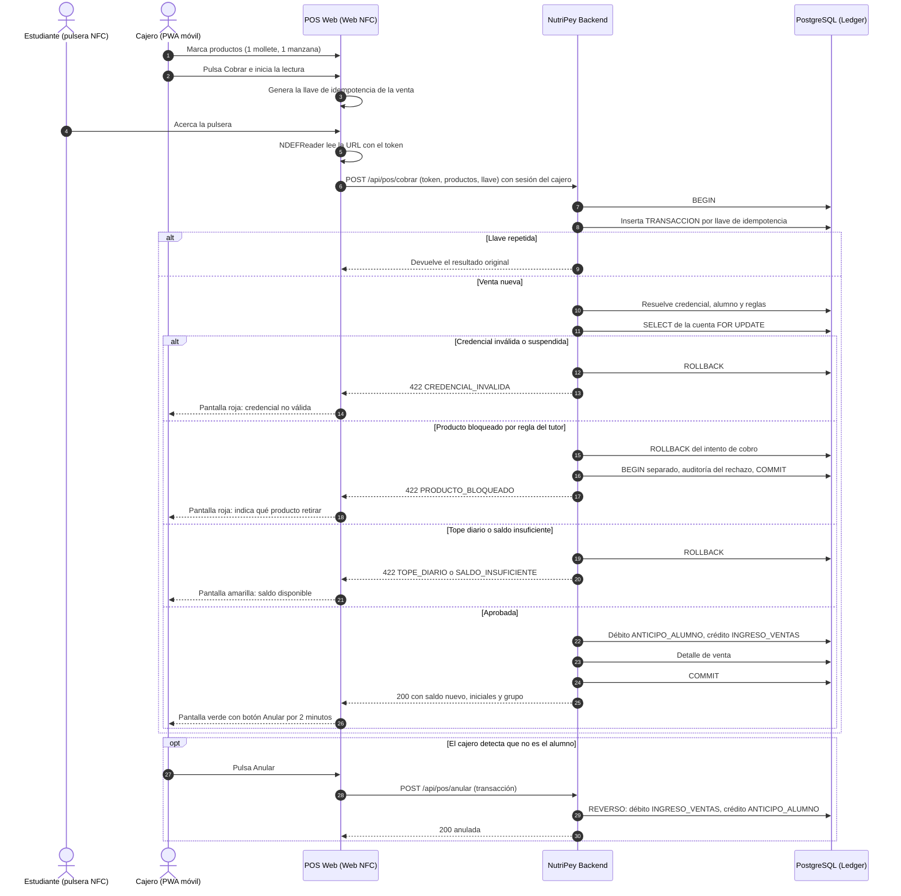
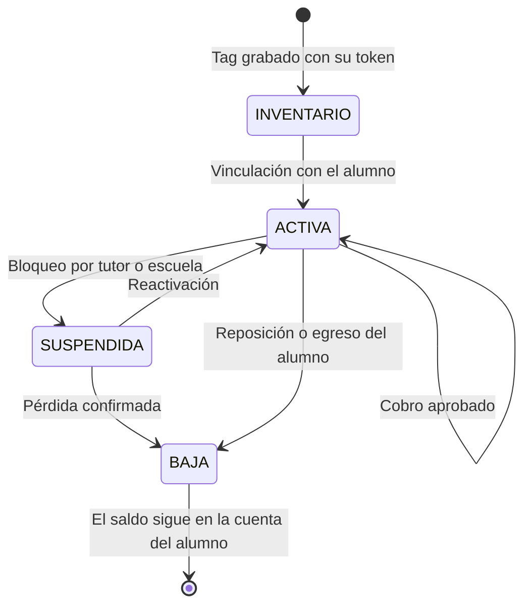

# Diagramas de Flujo y Secuencia — NutriPey

**Versión:** 1.2<br>
**Flujos:** recarga CoDi vía pey, conciliación, cobro en caja y ciclo de vida de la credencial.  
**Cambios respecto a 1.0:** ver [Auditoría y Decisiones](./05_auditoria_y_decisiones.md).

---

## 1. Recarga CoDi (Open-Loop On-Ramp)

El dinero va de la cuenta del tutor a la cuenta bancaria de la cooperativa. NutriPey solo recibe el aviso y asienta el anticipo.



**Puntos de diseño**

- Se responde a pey después de confirmar en base de datos; la consulta posterior del tutor ocurre en la PWA y no condiciona la respuesta al webhook.
- La correlación es por `codiQrId` en QR y por `transactionId` en push. `numRef` no se usa como llave: solo admite 7 dígitos.
- Se acredita el monto que reporta pey, no el que pidió el cliente.

---

## 2. Conciliación

Cubre los webhooks que nunca llegan y detecta diferencias entre el banco y el ledger.



---

## 3. Cobro en Cafetería (Closed-Loop Campus)

Una sola llamada y una sola transacción. Objetivo: p95 ≤ 800 ms de extremo a extremo.



**Puntos de diseño**

- Si la red falla después de enviar el cobro, el POS reintenta con la misma llave. No hay doble cobro.
- La pantalla de alérgeno no muestra el motivo médico, solo el producto a retirar.
- Sin Web NFC, el token llega por la URL del tag abierta con el lector nativo, por el QR del carnet o por matrícula más PIN. El resto del flujo es idéntico.

---

## 4. Ciclo de Vida de la Credencial

El saldo pertenece a la cuenta del alumno, no a la credencial.



## 5. Consulta del tutor en la PWA (decisión del 16 nov)

NutriPey no envía mensajes externos. El tutor abre la PWA cuando quiere, por ejemplo al final del día o de la semana:

```mermaid
sequenceDiagram
    actor Padre as Tutor
    participant PWA as PWA de padres
    participant API as NutriPey Backend
    participant DB as PostgreSQL
    Padre->>PWA: Abre el historial del alumno (día o semana)
    PWA->>API: GET historial (sesión del tutor, alumno, rango)
    API->>DB: historial(): comprueba vínculo vigente y lee movimientos y bloqueos
    DB-->>API: Compras, recargas, anulaciones, reembolsos, intentos bloqueados y saldo
    API-->>PWA: Página de 50 con cursor
    PWA-->>Padre: Resumen del periodo y saldo; resalta saldo bajo
```

Un fallo de la PWA no afecta cobros ni webhooks. Ver `historial` en el [contrato del ledger](./contratos/ledger.md).
