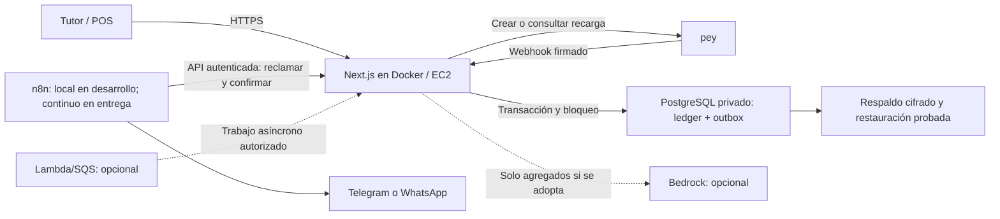

# Spec de entrega — NutriPey, 12 de diciembre de 2026

**Versión:** 1.2 · 15 noviembre. Diseño para revisión en PR #18; no describe software desplegado.
**Objetivo:** demostrar recarga real CoDi, cobro seguro, reverso, reglas del tutor y notificación con infraestructura reproducible.

## 1. Alcances y decisiones

| Alcance | Incluye | Criterio de salida |
| :--- | :--- | :--- |
| Prototipo kickoff, 15 nov 13:00 CDMX (#15) | Recorrido ilustrativo; simulaciones rotuladas | Entrega honesta del estado; no depende del producto completo ni lo certifica |
| Producto, 12 dic (#27) | RF-01–23 y RN/RNF vigentes | Evidencia funcional, contable, operativa y de privacidad; confirmar hora/formato final |
| Extensiones evaluables | Lambda/SQS (#20), Bedrock/RF-24 (#21) | Decisión registrada con costo, prueba y beneficio; no bloquean la entrega si no se adoptan |

Decididos por el equipo: Next.js + PostgreSQL, AWS y coordinación por tarea; Pagos antes de Campus. Diseño propuesto: Docker desde el inicio y EC2 como primer alojamiento. Disponibles según el equipo: 80 créditos AWS y n8n local; alcance, vigencia y configuración aún no verificados.
Fuera del MVP: modo offline, varias cuentas receptoras por escuela, reembolso automático, microservicios y promesa de alta disponibilidad. Un reembolso manual se registra conforme a RN-05.

## 2. Alternativas y arquitectura por etapas

| Alternativa | Beneficio / costo | Decisión de diseño |
| :--- | :--- | :--- |
| Docker/Compose en EC2 | Operación conocida, entorno reproducible; host único puede fallar | Base inicial; respaldos y recuperación obligatorios |
| Aplicación en EC2 y PostgreSQL separado (RDS candidato) | Separación operativa; costo y conexiones adicionales | Evaluar en #11 antes del 1 diciembre; registrar elección y limitaciones |
| Lambda/SQS para tareas acotadas | Escalar consumidores por eventos; reintentos y duplicados requieren diseño | #20 decide; no reemplaza el núcleo transaccional por defecto |
| n8n con operación continua | Flujos de mensajería verificables; requiere persistencia y mantenimiento | Local para desarrollo; alojamiento continuo en #22 para diciembre |
| Bedrock sobre agregados | Resumen narrativo; costo y riesgo de afirmaciones incorrectas | #21 decide contra alternativa determinista; nunca controla pagos |

La ubicación definitiva de PostgreSQL queda en #11: privado significa sin exposición pública, no necesariamente RDS ni alta disponibilidad. Los fondos se liquidan fuera de este diagrama, directamente en la cuenta de la cooperativa. La API es la única entrada al ledger; n8n no escribe sus tablas. MCP AWS es una herramienta de administración del equipo, no una dependencia del producto: inspección primero y cambios con alcance y permisos revisados.

## 3. Contratos e invariantes

- Agregar registro de reembolso manual RN-05 en #29, con contrato previo en #4, autorización, evidencia e idempotencia; no ejecuta transferencias. Mantener el [contrato del ledger](./contratos/ledger.md); #4 acuerda firmas, serialización de enteros seguros y semántica de reintentos. No introducir floats monetarios.
- #28 (eri2905) define el contrato de evaluación de reglas/catálogo dentro de la misma transacción y bloqueo. En #10, rslnt1270 conecta esa interfaz desde `src/server/ledger/` pasando el contexto transaccional; en #17, eri2905 implementa `src/server/reglas/` y `src/server/catalogo/` usando ese contexto, sin transacción independiente ni SQL del ledger. #12 valida núcleo con fixtures; #17 y #27 repiten con datos y reglas reales. No activar fixtures en producción.
- Webhook pey: cuerpo crudo verificado, correlación, deduplicación por evento y pago, validación de cuenta y monto, acreditación y outbox en la misma transacción; responder antes de mensajería. Consultar OpenAPI al implementar.
- Mensajería: #4 define contrato versionado de reclamar/confirmar/fallar eventos bajo `app/api/interno/notificaciones/` (Pagos), implementado por eri2905 en #13. Autenticación de servicio y alcance por destinatario obligatorios; los métodos/payloads se aprueban en #4; #13 implementa reservas temporales, intentos, backoff, máximo de reintentos y revisión manual. `eventId` estable por evento/destinatario y respuesta idempotente.
- El modelo del outbox debe ampliarse por migración nueva: canal, destinatario verificado, lease, resultado del proveedor y timestamps. Para rechazos por regla: hacer rollback del cobro y confirmar auditoría + outbox en otra transacción, deduplicada por intento/destinatario; no crear asientos. Si falla esa persistencia, devolver error reintentable y conservar la clave del intento, nunca declarar aviso encolado. Rechazos sin transacción necesitan referencia nullable. #4/#13 fijan contrato y pruebas. El ERD v1.1 es base, no esquema final aprobado de esta extensión.
- Aceptación por proveedor no equivale a entrega al teléfono. Si el envío ocurrió y se perdió la respuesta, puede duplicarse el aviso: registrar incertidumbre, sin prometer entrega exactamente una vez.
- Consentimiento y vínculo tutor/alumno vigentes antes de enviar; revocar destino debe impedir futuros avisos. No incluir nombres, fotos ni alergias de menores en mensajes, logs, pruebas o solicitudes a modelos.

## 4. Aceptación y trazabilidad

| Requisitos | Issues | Evidencia requerida |
| :--- | :--- | :--- |
| RF-01–07, RN-06 | #5, #7–9, #16, #24 | QR/push, firma inválida sin efectos, evento repetido y conciliación sin doble crédito |
| RF-08, RN-02 | #25, #26 | Efectivo con operador auditado; fronteras de límites y mes CDMX |
| RF-11–13, RN-01/03/05, RNF-03 | #6, #7, #10, #12, #29 | 20 cobros con saldo para 5: 5 aprobados; triple reintento único; reverso restaura saldo/límite; asientos cuadran |
| RF-09/10/14–18/22, RN-04 | #14, #17, #28 | NFC y alternativas, aislamiento de escuela/tutor, consentimiento, reglas reales y reporte agregado |
| RF-19–21/23 | #4, #13, #22 | Vinculación autorizada, recepción observable, caída/reintento y revocación; pagos continúan |
| RNF-01/02/05/06/08–12 | #11, #19, #23, #27 | p95 caja ≤800 ms/servidor ≤300 ms; webhook <2 s; restauración y rollback; métricas/costo |
| RNF-04/07 y reglas de dominio | Todos; #12/#27 consolidan | Datos ficticios, aislamiento y prueba pey exclusivamente de $0.01 MXN |
| RF-24 opcional | #21 | Evaluación de exactitud contra cifras SQL; fallback numérico y ausencia de datos personales |

Objetivo provisional de carga para #23: 20 solicitudes de cobro concurrentes, 1.000 operaciones sintéticas en PostgreSQL de prueba, tres repeticiones; registrar instancia, red, dataset, p50/p95 y errores. No ejecutar esa carga contra pey. #23 acuerda RPO/RTO y los prueba antes del 7 diciembre; no se declara recuperación cumplida sin restaurar.

## 5. Riesgos y decisiones pendientes

| Pendiente | Responsable / fecha objetivo | Salida |
| :--- | :--- | :--- |
| Cuenta pey ACTIVE y credenciales | rslnt1270, #5, antes de integración real | Bloqueo explícito si falta; simulación solo en prototipo |
| Región, costo, créditos y recursos existentes | rslnt1270, #30/#11/#23, antes de provisionar | Estimación de cómputo, almacenamiento, red, logs y servicios; alertas no son tope automático |
| Telegram o WhatsApp Cloud | eri2905, #13, antes del 1 dic | Un canal verificado; no mantener dos por obligación |
| PostgreSQL separado y n8n continuo | rslnt1270, #11/#22, antes del 7 dic | Prueba con PC apagada y recuperación; documentar puntos únicos de fallo |
| Lambda/SQS y Bedrock | Responsables #20/#21, antes del 7 dic | Adoptar con issues de implementación o diferir con razón; no ampliar alcance después del 8 dic |
| Validación legal y textos regulatorios | Equipo, antes de piloto real | Confirmar fuentes primarias y consentimiento; esta revisión no constituye validación legal |

## 6. Fuentes técnicas y estado

Documentación consultada el 15 noviembre: [Lambda/SQS](https://docs.aws.amazon.com/lambda/latest/dg/with-sqs.html), [precios Lambda](https://aws.amazon.com/lambda/pricing/), [precios Bedrock](https://aws.amazon.com/bedrock/pricing/), [créditos AWS](https://aws.amazon.com/awscredits/), [Telegram en n8n](https://docs.n8n.io/integrations/builtin/app-nodes/n8n-nodes-base.telegram/), [WhatsApp Cloud](https://docs.n8n.io/integrations/builtin/credentials/whatsapp/). Verificar versiones, región y condiciones al implementar; no se ha inspeccionado la cuenta AWS ni invocado un modelo. Plan ejecutable por fases: [09](./superpowers/plans/2026-11-15-entrega-diciembre.md).
