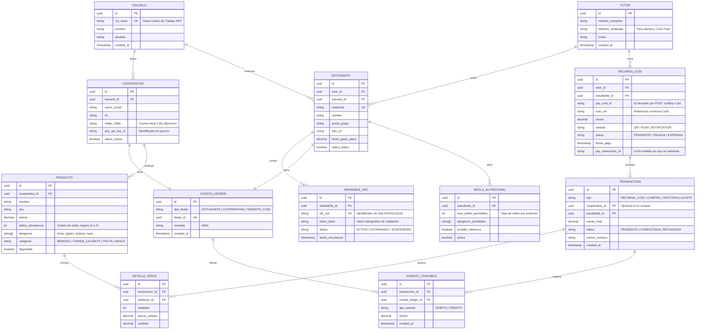

# Modelo de Datos y Diagrama Entidad-Relación (ERD) — NutriPey

**Versión:** 1.0  
**Arquitectura de Datos:** PostgreSQL con Contabilidad de Doble Partida (*Double-Entry Ledger*) y Trazabilidad ACID.

---

## 1. Diagrama Entidad-Relación (ERD)

---

## 2. Principios de Integridad Financiera

### A. Contabilidad de Doble Partida (*Double-Entry Ledger*)
Para garantizar que jamás exista discrepancia en el dinero real frente al virtual:
1. **Recarga CoDi exitosa de $100 MXN:**
   - `DEBITO` a Cuenta Concentradora CoDi en Tránsito (Activo).
   - `CREDITO` a la Cuenta Ledger del Estudiante (Pasivo/Monedero).
2. **Compra en Cafetería de $35 MXN:**
   - `DEBITO` a la Cuenta Ledger del Estudiante por $35.00 MXN.
   - `CREDITO` a la Cuenta Ledger de la Cooperativa por $35.00 MXN.
3. **Invariante Matemático:** $\sum \text{Débitos} = \sum \text{Créditos}$ en cada transacción.

---

## 3. Optimización de Índices para Baja Latencia en Caja
- `CREATE UNIQUE INDEX idx_wearable_nfc_uid ON wearable_nfc (nfc_uid) WHERE status = 'ACTIVO';`
- `CREATE INDEX idx_recarga_codi_numref ON recarga_codi (num_ref);`
- `CREATE INDEX idx_asiento_cuenta ON asiento_contable (cuenta_ledger_id, created_at DESC);`
- `CREATE INDEX idx_estudiante_tutor ON estudiante (tutor_id);`
