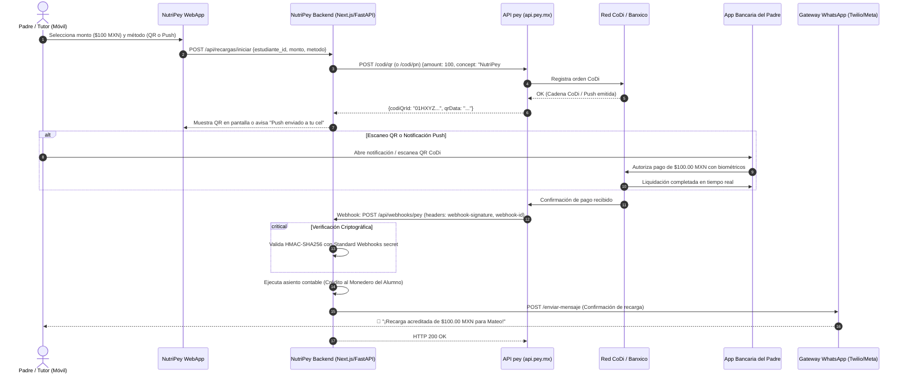
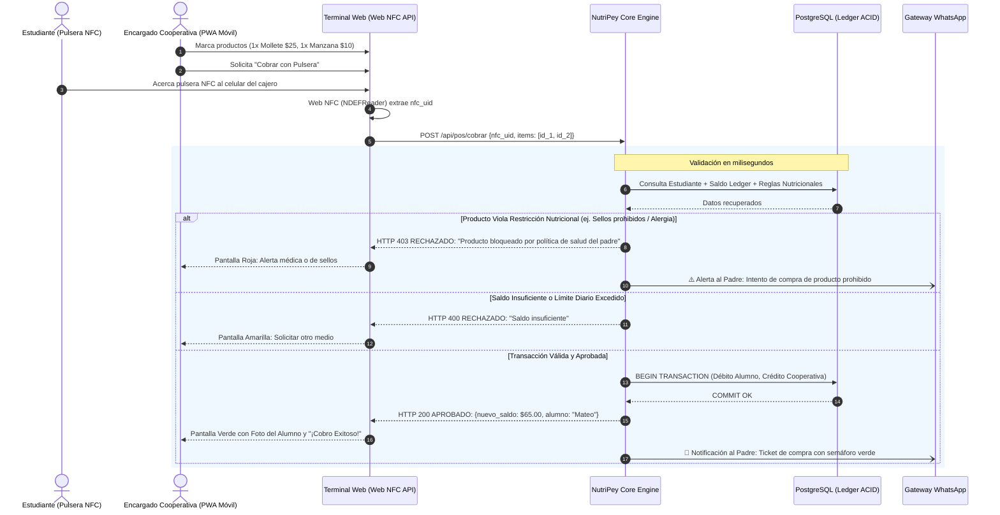
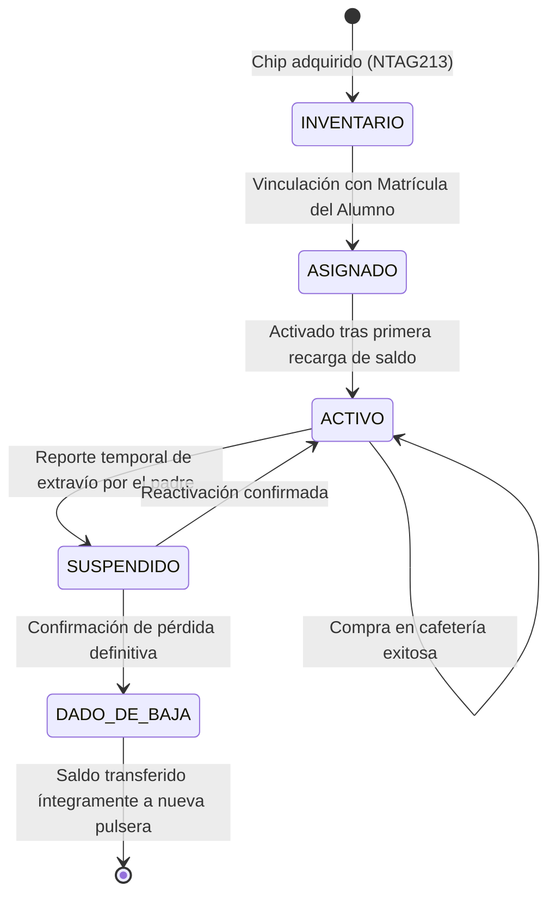

# Diagramas de Flujo y Secuencia — NutriPey

**Versión:** 1.0  
**Flujos Principales:** Recarga CoDi vía pey, Compra NFC en Caja con Motor Nutricional y Notificación WhatsApp.

---

## 1. Flujo de Secuencia: Recarga CoDi (Open-Loop On-Ramp)

Este flujo describe cómo el padre transfiere fondos desde su aplicación bancaria al monedero escolar del estudiante con 0% de comisión utilizando la API de pey y el webhook con Standard Webhooks.

---

## 2. Flujo de Secuencia: Compra en Cafetería Escolar (Closed-Loop Campus)

Este flujo describe la interacción de alta velocidad (< 500 ms) en la fila del recreo, validando saldo y salud antes de descontar.

---

## 3. Diagrama de Estados: Ciclo de Vida del Wearable NFC

